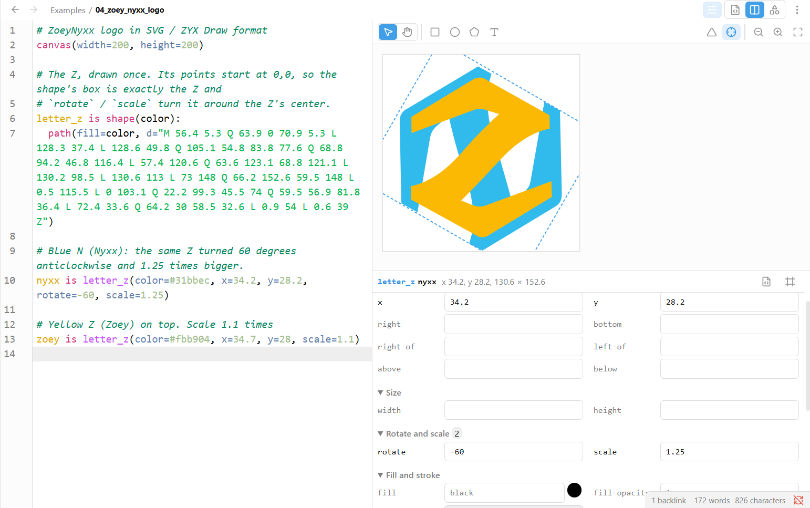
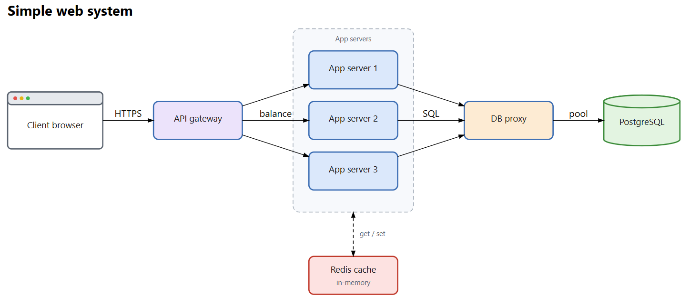
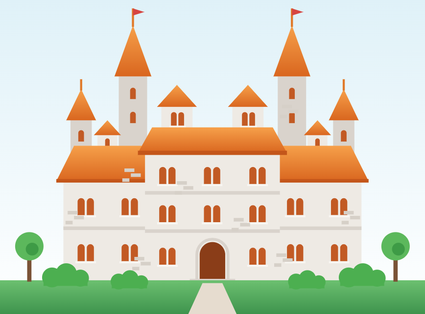
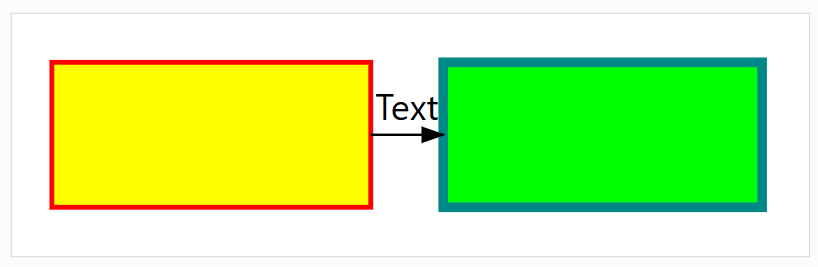
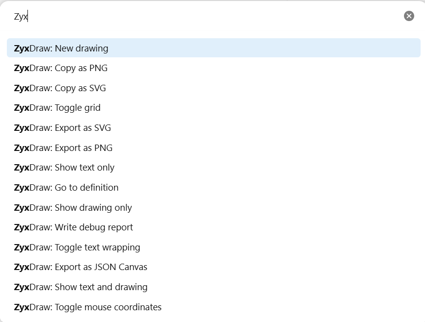
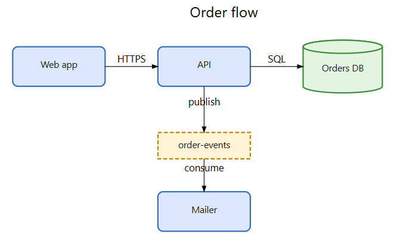
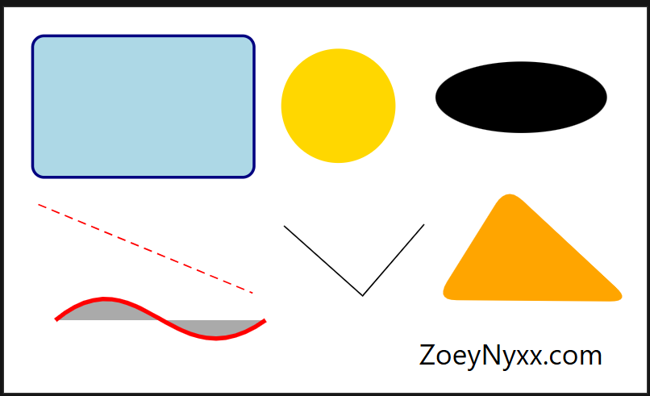

# ZyxDraw


ZyxDraw is the missing Drawing-as-Text (Yes, `text`; not `code`) tool. It is also `syntactic sugar` and a `superset` for `SVG` drawings, giving it extra features like making reusable libraries.

The text is written in **Zyxd**, a small language made for ZyxDraw (files end in `.zyxd`). You do not need to know any programming to read or write it.

It has a drawing board as well as text and attributes views. The aim is to make SVG as simple as text, and to make complex SVG graphics and vector drawings that can scale for complex drawings.

>### Origin of name
>
> Zyx (pronounced as Ziks) is one of the nicknames of the fiction-fantasy novel character [Zoey Nyxx](https://zoeynyxx.com) by [Kapil Sharma](https://kapsnotes.com).

## Active development as on November 2026

> Do you feel something will make your work easier?
>
> Open an issue in GutHub, I'm actively working to add more features in Zyx Draw.

## Some examples

Before we dive deep, let me first share some of the examples created in ZyxDraw. They could be created in drawing mode or text mode or combining their power.

> You can find generated text of these example images in GitHub repo's example folder, and copy-paste locally to generate same image and make some changes there.

### Zoey Nyxx Logo



### App wireframe


### System Design



### Hero's journey (Story writing guideline)


### Kingfisher


### Teddy


### A Landscape


### Palace



## Diving in details: Simple examples

Consider the following text

```
canvas(width=330, height=100)

primary is style(fill=yellow, stroke=red, stroke-width=2)
secondary is style(fill=rgb(0, 255, 0), stroke=#088, stroke-width=4)

block_a is rect(top=20%, left=5%, width=40%, height=60%, style=primary)
block_b is rect(
  right-of=block_a 30,
  top=20,
  width=40%
  height=60
  style=secondary
)

line(from=block_a, to=block_b, arrow=end, label="Text")
```

It will generate the following drawing



Not a fan of text? The preview section is also a proper drawing editor. Writing a drawing as text is completely optional and just gives us some extra powers to make drawings much easier and quicker. Let's quickly check what is written in the text of the above example.

### Canvas

Zyxd text usually starts with the canvas size, like

```
canvas(width=330, height=100)
```

Without it, the canvas is 1000 x 600. If you need an infinite canvas, you can have it too

```
canvas(infinite)
```

> An image can't be infinite. When exporting an infinite canvas, the generated SVG or image has a height and width that cover all drawing elements (plus 20 px).

### Styles

#### Primary

We can define some of the styles that we may reuse later. The following line does just that

```
primary is style(fill=yellow, stroke=red, stroke-width=2)
```

The syntax is `name is type`. Here, `primary` is just a name that we want to refer to later, while applying the style.

`style` is a reserved keyword to represent styles. This means you cannot use `style` as a name. The other reserved keywords are `is`, `shape`, `clip`, `gradient`, `canvas` and `import`, and the built-in shape types (`rect`, `circle`, `polygon`, ...) cannot be names either.

After style, we have `()`. Within it, we have attributes, which are in the format `attribute=value`. There is a huge list of attributes, which we will see later in detail. They are also visible in the attributes view, below the drawing area.

#### Secondary

Similarly, we defined `secondary` style too as

```
secondary is style(fill=rgb(0, 255, 0), stroke=#088, stroke-width=4)
```

It is the same as the primary style, but it shows examples of writing colors. We can write colors as:

- `Name` like `red` and `yellow`
- `RGB code` like `rgb(0, 255, 0)` (Green color)
- `Color hex` like `#088` (which is the same as `#008888`) (Teal, a darker shade of cyan - by mixing green and blue)

### Shapes

#### block_a

Like styles, the second important part of ZyxDraw is shapes. A shape defines the boundaries of a drawing object. There are some basic shapes built in, like rectangle (`rect`). The next line draws a rectangle with a predefined style

```
block_a is rect(top=20%, left=5%, width=40%, height=60%, style=primary)
```

You can probably read the syntax now. `block_a` is the name to refer to later in the drawing. `rect` is a built-in shape. Its attributes define how to draw the rectangle.

- `top=20%`: Since the height is 100 (pixels), 20% will start at 20 pixels.
- `left=5%`: We have a width of 330 pixels. So 5% will be 16.5 pixels.
- `width=40%`: 132 pixels (40% of the width, 330 pixels)
- `height=60%`: 60 pixels (60% of the height, 100 pixels)
- `style=primary`: Here we reuse the style we defined earlier. This reuse is the power of ZyxDraw. It will apply all the attributes we defined in style `primary`.

> We can also define things in exact coordinates and pixels.

#### block_b

We defined `block_b` as:

```
block_b is rect(
  right-of=block_a 30,
  top=20,
  width=40%
  height=60
  style=secondary
)
```

There is nothing special. It is defined just like block_a, with different attribute values and a different style. One new thing is `right-of=block_a 30`: instead of an `x` position, `block_b` is placed 30 pixels to the right of `block_a`, so it follows when `block_a` moves. If there are too many attributes, we can define them on multiple lines for easier reading.

When we define attributes on multiple lines, the comma is optional (we have a comma after the first two values but not after the last three). However, it is recommended to stick to a single style.

#### Line

At the end, we have a line

```
line(from=block_a, to=block_b, arrow=end, label="Text")
```

We can obviously define exact coordinates of start and end of line. However, in this example, we defined it in reference to existing shapes (`from=block_a, to=block_b`). This is another super-power of ZyxDraw: making relationships between shapes.

We also have the attribute `arrow=end`. So a line in ZyxDraw can act as an arrow, depending on the `arrow` attribute. Possible values are: `none`, `start`, `end`, `both`. If we do not define the arrow attribute, default is `none`, which is just a line.

## Second example

Before diving deep, let's take one more example, a bit more complex (curved lines), but it is also simple.


This example shows how I made the Zoey Nyxx logo in ZyxDraw, with the following Zyxd text

```
canvas(width=200, height=200)

# The Z, drawn once. Its points start at 0,0, so the shape's box is exactly the Z.
letter_z is shape(color):
  path(fill=color, d="M 56.4 5.3 Q 63.9 0 70.9 5.3 L 128.3 37.4 L 128.6 49.8 Q 105.1 54.8 83.8 77.6 Q 68.8 94.2 46.8 116.4 L 57.4 120.6 Q 63.6 123.1 68.8 121.1 L 130.2 98.5 L 130.6 113 L 73 148 Q 66.2 152.6 59.5 148 L 0.5 115.5 L 0 103.1 Q 22.2 99.3 45.5 74 Q 59.5 56.9 81.8 36.4 L 72.4 33.6 Q 64.2 30 58.5 32.6 L 0.9 54 L 0.6 39 Z")

# Blue N (Nyxx): the same Z turned 60 degrees anticlockwise and 1.25 times bigger.
nyxx is letter_z(color=#31bbec, x=34.2, y=28.2, rotate=-60, scale=1.25)

# Yellow Z (Zoey) on top, 1.1 times bigger.
zoey is letter_z(color=#fbb904, x=34.7, y=28, scale=1.1)
```

I'll leave you to read the text above. Some of the features it uses:

- Comments start with `#`. They do not take part in the drawing; they are for us, to later recall why we wrote a line.
- Definition (`letter_z`): If you know some programming, consider it a function. A `definition` groups together multiple shapes that we may reuse later.
  - There is some syntax though, which is inspired by the Python programming language.
    - A definition block starts after `:`
    - A definition block has indentation. You can see two spaces before `path`; that space makes `path` part of `letter_z` (not an individual shape)
  - ZyxDraw also supports libraries: a group of common shapes that we may reuse in multiple drawings.
- `path` may look strange, but it is a simple SVG path. You can read about it online, or we will see more examples/tutorials to define paths.
  - An easier option in ZyxDraw and SVG is the polygon (when you do not need curves). I used a path as there are some curves in our shape.
- Once we defined the shape `letter_z`, we can reuse it in the next two lines:
  - `nyxx` is the same letter in blue, rotated 60 degrees counter-clockwise. It is also scaled (enlarged) by 1.25 (125%).
  - Then, `zoey` is the same shape in yellow, scaled only 1.1 (110%) this time.
  - You may also notice layering. Any shape drawn later is drawn above the previously drawn shapes.

> **More examples**
>
> We have unlimited possibilities with vector graphics in ZyxDraw. Some more examples are given at the end of this file, just scroll down.

## Why I developed ZyxDraw?

There are many great drawing editors, and many diagram-as-code tools too, so the obvious question is, why is ZyxDraw needed? I personally needed it to solve the following problems for myself:

- My drawings need to be strictly SVG, so that it can scale anywhere (Print, small logo, big images, etc).
  - `Requirement 1`: Must export as SVG + other image formats
- SVG's XML is not an easy format to write, at least not for non-coders.
  - `Requirement 2`: Creating diagrams easily while typing in a script, that reads like English.
  - The goal is not to type everything for a new drawing - I need the best of both worlds.
- In SVG, I need to copy-paste code every time I want to reuse something.
  - `Requirement 3`: Easy to design library of custom shapes and reuse them anywhere later.
- Editing SVG: When we have a lot of points, especially in shapes like polygons, tracking points in an SVG editor is not easy.
  - `Requirement 4`: Make point editing easy in the text view. Selecting a shape or point in the editor should move the cursor in the text, to quickly adjust it.

Above were the major requirements for which ZyxDraw exists. Since I have achieved them already (before open-sourcing it as an Obsidian plugin), I will keep adding more features to make it even easier.

> I welcome to use the editor and suggest the next feature that will make things easier for you. If it do not break SVG output, I'll take it on priority.

## Obsidian Commands

The plugin, in its first version, comes with a lot of useful commands, and the list keeps growing.



## Getting started

- **New drawing:** right-click a folder in the file explorer and choose **New ZyxDraw drawing**, or use the ribbon icon or the command **ZyxDraw: New drawing**. It asks for the name, then creates and opens the `.zyxd` file.
- **Three views:** There are three views, available at the click of a button or with the `ZyxDraw: Show ...` commands.
  - Text and drawing side by side
  - Text only
  - Drawing only
    - We also have an attributes view below the drawing view.
- **Go to definition:** `Ctrl` + click (`Cmd` on Mac) on a name in the text: a custom shape (opens its library in a new tab), an import path, a shape in `right-of=`, `from=`, ..., a style, a clip or a gradient. Hold `Ctrl` to see what is clickable. Also the command **ZyxDraw: Go to definition** (for the name at the cursor).
- **Hide shapes while you work:** click the eye next to a shape's line number in the text to hide it (it writes `display=none`); click again to show it. The lines of a hidden shape are faded. Hidden shapes keep their place, so shapes and lines attached to them do not move. See [Hiding shapes](#hiding-shapes).
- **Comment lines:** `Ctrl+/` (`Cmd+/` on Mac) comments or uncomments the selected lines in the text.
- **In notes:** a fenced code block with the language `zyxd`, or an embed `![[diagram.zyxd]]`, shows the drawing.

## Editing on the drawing

| Action | How |
| ------ | --- |
| Select | Click. The first click selects the outer group, clicking again goes one level deeper. Double-click selects the innermost shape |
| Select several | `Shift`+click adds or removes a shape; drag a box on empty space to select the shapes inside it; `Ctrl+A` selects all. Hidden shapes (`display=none`) are skipped. Move, nudge, delete, color, copy and group then work on all of them |
| Move | Drag, or arrow keys (Shift for 10 px) |
| Resize | Drag a handle (rectangles, circles, ellipses, groups with a size) |
| Edit points | Select a path, polygon, polyline or line: drag its points (squares) or curve control points (circles). A point takes its curve handles along, and a smooth point stays smooth when you drag one of its handles (hold `Alt` to make a corner). Only those numbers change in the text. With text and drawing side by side, clicking a point selects its numbers in the text |
| Delete | `Delete` or `Backspace` |
| Copy, cut, paste | `Ctrl+C`, `Ctrl+X`, `Ctrl+V` (`Cmd` on Mac), or right-click. Shapes are copied as Zyxd text, so they also paste into the text editor or another drawing. Names already used get a number (`box` → `box1`) |
| Duplicate | `Ctrl+D`, or right-click: a copy 10 px down and right, drawn on top |
| Group / ungroup | `Ctrl+G` / `Ctrl+Shift+G`, or right-click. Nothing moves on the canvas |
| Fill and stroke color | Toolbar color buttons: pick a color, none, or one of the file's gradients, for every selected shape |
| Layer order | Right-click: bring to front, forward, backward, send to back |
| Find in text | Right-click: Show in text |
| Add a shape | Toolbar: rectangle, circle, text |
| Draw a line | Toolbar line button (`L`): drag, or click both ends. Hold `Shift` for 45° steps |
| Draw a polygon | Toolbar polygon button (`P`): click to place points, click the first point or press `Enter` to finish |
| Draw a path (pen) | Toolbar pen button (`B`): click for a corner, press and drag for a smooth curve. Click the first point to close the shape, or press `Enter` (or double-click) to leave it open. `Backspace` removes the last point |
| Add / delete points | On a selected polygon, polyline or path, click or drag the dot in the middle of a side to add a point (on a curve, it splits the curve without changing its shape); click a point and press `Delete` to remove it |
| Attributes | Attributes button in the view header: a form under the drawing for the selected shape, or the canvas when nothing is selected. Press Enter or leave the field to apply; clear a field to remove the attribute |
| Zoom | Toolbar, or `Ctrl` + mouse wheel |
| Grid | Toolbar grid button: lines spaced to suit the zoom. While it is shown, moving, resizing and point dragging snap to it; hold `Alt` to drag freely |
| Mouse coordinates | Status bar shows the mouse position over the drawing, in pixels and percent. With a group, custom shape or path selected, also in that shape's own numbers (what you type in `d` or `points`). Toolbar crosshair button turns it off |
| Undo / redo | `Ctrl+Z` / `Ctrl+Shift+Z` (also in the drawing) |

Every drawing edit changes only the numbers it must in the text, keeps their unit (`10%` stays a percent), and is one undo step. Comments and formatting are kept. Dragging a shape that is anchored (`right-of=api 60`) along that axis replaces the anchor with a position, and a notice says so.

## Working examples

Below are some examples that I made with ZyxDraw, given here to show the possibilities.

### System design

Drawn in the editor first, later adjusted in the text



Code for this

```
import service, database, queue from shapes/system

canvas(width=720, height=380, background=white)

title is text("Order flow", x=50%, y=16, font-size=22, align=middle)

web is service(label="Web app", x=40, y=80, width=140)
api is service(label="API", right-of=web 80, y=80)
orders is database(label="Orders DB", width=120, right-of=api 80, y=70)
events is queue(label="order-events", below=api 70, x=260)
mailer is service(label="Mailer", below=events 50, x=260)

line(from=web, to=api, arrow=end, label="HTTPS")
line(from=api, to=orders, arrow=end, label="SQL")
line(from=api, to=events, arrow=end, label="publish")
line(from=events, to=mailer, arrow=end, label="consume")
```

It also uses another file, imported from `shapes/system`, with the following code

```
label is style(font-size=14, fill=#1a1a1a)

service is shape(label, width=140, height=60, color=#dbe8fb):
  body is rect(width=100%, height=100%, radius=8, fill=color, stroke=#3b6db3, stroke-width=2)
  name is text(label, x=50%, y=20, align=middle, style=label)

database is shape(label, width=120, height=80, color=#e3f4e1):
  body is rect(width=100%, height=100%, rx=width / 2, ry=10, fill=color, stroke=#3c8c3a, stroke-width=2)
  lid is ellipse(x=0, y=0, rx=width / 2, ry=10, fill=color, stroke=#3c8c3a, stroke-width=2)
  name is text(label, x=50%, y=35, align=middle, style=label)

queue is shape(label, width=140, height=40):
  body is rect(width=100%, height=100%, fill=#fff4d6, stroke=#b8860b, stroke-width=2, stroke-dasharray="6 3")
  name is text(label, x=50%, y=12, align=middle, style=label)
```

### App wireframe


Generated text in file [examples/07_app_wireframe.zyxd](./examples/07_app_wireframe.zyxd)

### System design on an infinite canvas


Generated text in file [examples/08_system_design_sample.zyxd](./examples/08_system_design_sample.zyxd)

### Hero's Journey


Generated text in file [examples/10_heros_journey.zyxd](./examples/10_heros_journey.zyxd)

### Vector art: a kingfisher


Every part of the bird is a path made of lines and curves, written exactly as the pen tool writes it. Open it, select a part, and drag its points and curve handles to reshape it. Text in file [examples/11_kingfisher.zyxd](./examples/11_kingfisher.zyxd). One part of it:

```
head is path(d="M 296,142 C 296,98 336,72 380,76 C 422,80 448,108 444,146 L 404,162 C 368,168 326,162 296,142 Z", fill=#6a2c91)
```

- `M 296,142` moves to the first point.
- `C 296,98 336,72 380,76` draws a curve to `380,76`; the first two pairs are its curve handles.
- `L 404,162` draws a straight line, and `Z` closes the shape back to the first point.

## More examples and text style guide

### Shapes

```python
canvas(width=450, height=270)

box is rect(x=20, y=20, width=155, height=99, radius=8, fill=lightblue, stroke=navy, stroke-width=2)
dot is circle(cx=234, cy=69, r=40, fill=gold)
oval is ellipse(x=302, y=38, rx=60, ry=25)
any_line is line(x1=24, y1=138, x2=174, y2=200, stroke=red, stroke-dasharray="6 4")
zig_zag is polyline(points="0,0 55,49 98,-1", fill=none, stroke=black, x=196, y=153)
tri is polygon(points="50,0 137,81 0,80", fill=orange, radius=15, x=302, y=125)
sine is path(d="M 0 0 C 60 -50 83 46 147 0", fill=#AAA, stroke=red, stroke-width=3, x=36, y=219)
footer is text("ZoeyNyxx.com", x=355, y=233, font-size=20, align=middle)
```

- `name is type(attributes)`. The name is optional; you only need it to refer to the shape.
- Attribute names and values follow SVG. Every attribute has a default.
- Long attribute lists may span several lines; commas are then optional.
- Comments start with `#`.
- `x` / `y` (or `left` / `top`) are the top-left of the shape's box. Circles and ellipses also take `cx` / `cy`.

It will produce the following drawing:



### Position and size

Example code

```python
a is rect(x=10%, y=20, width=50%, height=40)     # percent of the parent (or canvas)
b is rect(right=20, bottom=20, width=100, height=50)  # from the right and bottom edges
c is rect(left=10%, right=10%, y=0, height=30)   # stretch: left + right set the width
d is rect(right-of=a 40, below=c 10)             # relative to other shapes, with a gap
```

- Relative: `right-of`, `left-of`, `above`, `below`. One per axis.
- There will be an error on any conflict. Example: two ways to place the same axis, opposite anchors, or a loop of anchors (`a` right of `b`, `b` right of `a`).
- `canvas(width=..., height=..., background=...)` sets the frame used for percent. Without it the frame is 1000 x 600.
- `canvas(infinite)` has no frame: the SVG is sized to what is drawn (plus 20 px), positions may be negative, and top-level shapes use pixels (`%` and `right` / `bottom` need a group with a size). The drawing view gives room to draw anywhere.

### Rotate and scale

```python
card is rect(x=150, y=50, width=100, height=50, rotate=30)        # degrees, clockwise
Nyxx is letter_z(color=gold, rotate=-57.5, scale=1.1)                  # custom shapes too
back is polygon(points="0,20 60,20 60,0 100,40 60,80 60,60 0,60", scale=-1 1)   # mirror
```

Around the center of the shape's box. They change only the drawing: positions, anchors and `%` use the unturned box. `scale` takes one number, or two (horizontal, vertical).

### Groups

```python
server is group(x=100, y=50):
  box is rect(width=200, height=100, fill=lightgray)
  title is text("API Server", x=10, y=10)

line(from=server.box, to=db)
```

Attributes go in `( )`, children are indented below `:`. Names only need to be unique among siblings; refer to a child as `server.box`. Children are placed from the group's top-left. A group whose children use `%` needs a `width` and `height`.

### Styles

```python
card is style(fill=white, stroke=gray, stroke-width=2, radius=8)
a is rect(width=100, height=60, style=card)
b is rect(width=100, height=60, style=card bold, fill=yellow)   # own attributes win
```

Several styles apply left to right. Styles cannot set positions.

### Hiding shapes

```python
back is rect(width=300, height=200, fill=lightgray, display=none)
front is rect(x=20, y=20, width=100, height=60, fill=orange)
```

`display=none` hides a shape, a group or a custom shape, as in SVG. It still has its place, so anchors (`right-of=back`) and lines to it keep working. It is saved in the file and exported as `display="none"`. The eye next to each shape in the text editor adds or removes it. Hidden shapes cannot be selected in the drawing.

### Clipping

```python
top-half is clip():
  rect(width=100%, height=50%)

c is circle(cx=50, cy=50, r=50, fill=red, clip-path=top-half)
```

Only the parts inside the clip's shapes stay visible. Shapes in a clip are placed in the clipped shape's box (`%` of that shape), so one clip fits any size. Works on groups too.

### Gradients

```python
canvas(width=400, height=240, background=sky)
sky is gradient(from=#7a2a5a, to=#f6c3a8, angle=90)
sun is gradient(type=radial, from=#fff6c8, to=#ff9a5a)
glow is gradient(type=radial):
  stop(offset=0%, color=#ffd36e, opacity=0.9)
  stop(offset=100%, color=#ffd36e, opacity=0)

halo is circle(cx=300, cy=80, r=70, fill=glow)
ball is circle(cx=300, cy=80, r=35, fill=sun)
```

A gradient is used by name wherever a color goes: `fill`, `stroke`, `background`, styles and custom shape parameters. `angle` turns a linear gradient (0 = left to right, 90 = top to bottom); `type=radial` blends from the center outwards. More colors go in indented `stop(...)` lines, and a color fading to `opacity=0` gives a soft glow. It stretches over each shape's box, and is written as a plain SVG `linearGradient` / `radialGradient`.

### Custom shapes and libraries

```python
database is shape(label, width=120, height=80, color=steelblue):
  body is rect(width=100%, height=100%, fill=color, radius=10)
  name is text(label, x=10, y=30)

users is database(label="Users", x=20, y=20)
orders is database(label="Orders", right-of=users 40, y=20, color=orange)
```

- A parameter without a default is required.
- Numbers can be calculations using the parameters: `rx=width / 2`, `y=(height - 20) / 2`. Put spaces around `-` (names may contain `-`).
- Instances take their parameters plus position and style attributes.
- Put shapes in a `.zyxd` file and import them: `import database, queue from shapes/system.zyxd`. Paths are relative to the drawing, then from the vault root. `.zyxd` may be omitted.
- Inner parts of a shape from the same file can be referenced (`users.body`). Imported shapes are sealed.
- Later imports override earlier ones, and a local definition always wins. Circular imports and definitions are reported.

## Export

Commands, or the file menu of a `.zyxd` file:

- **Export as SVG / PNG**: saved next to the drawing. PNG scale and background are in settings.
- **Export as JSON Canvas**: boxes, text, groups and connected lines become an Obsidian canvas. Other shapes are skipped with a notice.
- **Copy as SVG / PNG**: to the clipboard.

### Clipboard use

ZyxDraw uses the system clipboard only when you ask it to:

- It **writes** to the clipboard when you copy or cut shapes (`Ctrl+C`, `Ctrl+X`, or the right-click menu), or use **Copy as SVG / PNG**.
- It **reads** the clipboard only when you paste into the drawing (`Ctrl+V`, or **Paste** in the right-click menu).

Nothing is read in the background, and nothing leaves your device.

## Settings

- Default view (split, text, drawing).
- Wrap long lines in the text editor (also the command **ZyxDraw: Toggle text wrapping**).
- Show layer toggles in the text editor: the eye icons that hide and show shapes.
- Show grid, and show mouse coordinates (also toolbar buttons and the commands **Toggle grid** / **Toggle mouse coordinates**).
- Unit for new positions and sizes written by the drawing view (percent or pixels).
- PNG scale and background.

## Development

Requirements: Node.js (LTS or newer) and npm.

```sh
npm install
npm test          # unit tests and docs examples (plain Node)
npm run lint      # includes the "core must stay pure" rule
npm run build     # type check + production bundle -> main.js
npm run dev       # watch mode
```

To try it in a vault, point the build at the vault's plugin folder:

```powershell
$env:OBSIDIAN_PLUGIN_DIR = "C:\path\to\vault\.obsidian\plugins\zyxdraw"
npm run dev
```

Or put that path on the first line of a git-ignored file named `.obsidian-plugin-dir` in the repo root. Each build copies `main.js`, `manifest.json` and `styles.css` there. The **Hot Reload** community plugin reloads ZyxDraw after each build.

Layout:

- `src/core/`: pure TypeScript (parser, resolve, layout, SVG, edits, JSON Canvas). No Obsidian or DOM, enforced by lint.
- `src/plugin/`: Obsidian views, drawing editor, commands, export, embeds, settings.
- `tests/`: Vitest. `tests/docs/` runs the examples from the language reference when `ZYX_DOCS_DIR` (or the default private docs folder) exists.

### Release

Once per repository: in GitHub, **Settings → Actions → General → Workflow permissions**, choose **Read and write permissions**.

1. Update `version` in `manifest.json` and `package.json`, and add it to `versions.json` with the minimum Obsidian version.
2. Commit, then tag with the same version (no `v` prefix) and push the tag: `git tag -a 0.1.0 -m "0.1.0"` and `git push origin 0.1.0`.
3. The release workflow runs the tests, checks the tag matches `manifest.json`, builds, attests the build (signed provenance, recommended for the community directory) and attaches `main.js`, `manifest.json` and `styles.css` to a draft GitHub release with generated notes. Review and publish it.

## License

MIT
