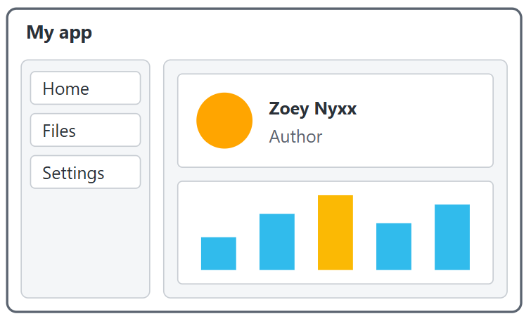
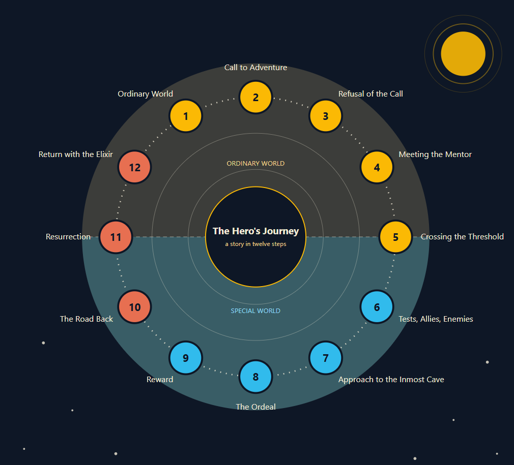
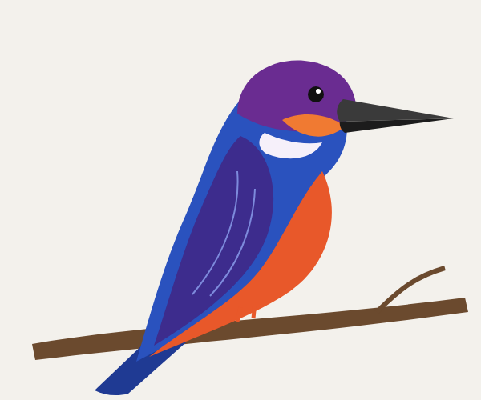

# ZyxDraw


**Drawing as text for Obsidian.** Type a few readable lines, or draw with the mouse. Both stay in step, and every drawing exports to plain SVG.

<!--
  GIF goes here (about 10 seconds): text on the left, drawing on the right.
  Type a line, the shape appears; drag a shape, its numbers change in the text. Until it is recorded, the picture below stands in.
-->


## Why ZyxDraw

- **Type or drag: both stay in step.** Type and the drawing updates. Drag a shape and only the numbers that changed are rewritten in the text.
- **Readable text.** `api is service(label="API", right-of=web 80)` reads almost like English. No programming needed.
- **Good with AI.** The text is short, so an AI assistant can write and change your drawings, and fix them from clear problem messages.
- **Plain SVG, always.** Export to SVG or PNG, which open anywhere. If you stop using ZyxDraw, you keep your drawings.
- **Reuse your shapes.** Make custom shapes once, keep them in libraries, and use them in any drawing.
- **Part of your notes.** Drawings are text files in your vault: you can search them, link them and embed them in any note.

ZyxDraw is a quick tool for people taking notes. It is not trying to replace any other drawing, diagram or design tool. There are many excellent ones, and ZyxDraw sits happily next to them. Read [Why ZyxDraw](https://github.com/kapilsharma/ZyxDraw/blob/main/WhyZyxDraw.md) for its goals and non-goals.

## What you can draw

<table>
  <tr>
    <td><br><a href="./examples/02_system_design.zyxd">System design</a></td>
    <td><br><a href="./examples/07_app_wireframe.zyxd">App wireframe</a></td>
  </tr>
  <tr>
    <td><br><a href="./examples/10_heros_journey.zyxd">Hero's journey</a></td>
    <td><br><a href="./examples/08_system_design_sample.zyxd">Infinite canvas</a></td>
  </tr>
  <tr>
    <td><br><a href="./examples/11_kingfisher.zyxd">Kingfisher</a></td>
    <td><br><a href="./examples/12_teddy.zyxd">Teddy</a></td>
  </tr>
</table>

Every picture is made from a short `.zyxd` text file. Click a name to read its text.

## A 30-second example

```text
canvas(width=330, height=100)

primary is style(fill=yellow, stroke=red, stroke-width=2)
secondary is style(fill=rgb(0, 255, 0), stroke=#088, stroke-width=4)

block_a is rect(top=20%, left=5%, width=40%, height=60%, style=primary)
block_b is rect(right-of=block_a 30, top=20, width=40%, height=60, style=secondary)

line(from=block_a, to=block_b, arrow=end, label="Text")
```


- `name is type(...)` gives a shape or style a name, so you can use it later.
- A **style** is a set of colors and lines you can reuse: `style=primary`.
- `right-of=block_a 30` places `block_b` 30 pixels to the right of `block_a`. Move `block_a` and `block_b` follows.
- `line(from=..., to=...)` joins two shapes, and stays joined when they move.

The [tutorial](docs/tutorial.md) goes through this example line by line.

## Use it with AI

Zyxd is new, so AI assistants don't know it yet. Give yours the [Zyxd guide for AI](docs/zyxd-for-ai.md) first: one page with the whole language, tested examples and common mistakes. Then ask for your drawing:

> *Read this guide: https://raw.githubusercontent.com/kapilsharma/ZyxDraw/main/docs/zyxd-for-ai.md. Then write a ZyxDraw drawing of a login flow: a user, a web app, an API and a database, joined by labelled arrows.*

If your assistant can't open web links, paste the guide's text in instead.

Paste the answer into a `.zyxd` file and the drawing appears. Then drag shapes into place, or ask for changes ("make the database green", "put the API below the web app"). If something is wrong, the problems are listed under the drawing with their line. Copy them back to the assistant to fix.

## Features

| Feature | What it gives you |
| ------- | ----------------- |
| [Editing in the drawing area](docs/editing.md#editing-in-the-drawing-area) | Select, move, resize, edit points, group, copy and paste, draw lines, polygons and curves, snap to a grid, undo |
| [Drawing paths](docs/paths.md) | Lines and shapes with curves and arcs: the pen, the curve tool (click points, get a smooth curve), changing a path by dragging, and what the numbers in `d` mean |
| Text editor | Syntax colors, autocomplete, problems underlined with the reason, `Ctrl`+click to go to a definition |
| [Attributes, Layers and Help](docs/editing.md#getting-started) | The **Attributes** of the selected shape in the bottom panel, and the **Layers** and **Help** tabs in the right panel. **Help** explains the tool in use |
| [Custom shapes and libraries](docs/language.md#custom-shapes-and-libraries) | Shapes with parameters, kept in `.zyxdl` library files and shared by many drawings. [Ready-made libraries](library/README.md) included |
| [Gradients](docs/language.md#gradients) and [clipping](docs/language.md#clipping) | Smooth color blends and cut-out shapes, written as plain SVG |
| [Infinite canvas](docs/language.md#position-and-size) | `canvas(infinite)` for drawings that keep growing |
| In your notes | A ```` ```zyxd ```` code block, or an embed `![[diagram.zyxd]]`, shows the drawing inside a note |
| [Export](docs/editing.md#export) | SVG, PNG, or an Obsidian canvas. Or copy as SVG or PNG |

## Getting started

1. In Obsidian, open **Settings → Community plugins → Browse**, search for **ZyxDraw**, then install and enable it.
2. Right-click a folder and choose **New ZyxDraw drawing**, or click the ZyxDraw icon in the ribbon.
3. Type in the left panel, or draw in the drawing area with the toolbar.
4. Put `![[your drawing.zyxd]]` in any note to show it there.

To install by hand instead, download `main.js`, `manifest.json` and `styles.css` from the [latest release](https://github.com/kapilsharma/ZyxDraw/releases) into `.obsidian/plugins/zyxdraw/` in your vault, then enable ZyxDraw.

## Learn more

- [Tutorial](docs/tutorial.md): your first drawings, step by step.
- [Zyxd guide for AI](docs/zyxd-for-ai.md): the whole language on one page, for AI assistants (and quick readers).
- [Language reference](docs/language.md): shapes, positions, groups, layers, styles, gradients, custom shapes and libraries.
- [Using ZyxDraw in Obsidian](docs/editing.md): panels, every mouse action and shortcut, commands, export and settings.
- [Examples](examples/): the text of every drawing on this page, and more.

## Privacy

ZyxDraw works offline and sends nothing anywhere. It uses the clipboard only when you copy, cut or paste shapes, or choose **Copy as SVG / PNG**. It never lists the files of your vault: it opens the drawings you open, the libraries they import (by name, in their own folder or the library folder), and, when you create a file, looks only in the folder it goes into.

## Contributing

Ideas and bug reports are welcome as [GitHub issues](https://github.com/kapilsharma/ZyxDraw/issues). ZyxDraw is actively developed, and a feature that keeps plain SVG output goes to the front of the queue. To build it yourself, see [CONTRIBUTING.md](CONTRIBUTING.md).

## About the name

Zyx (said "Ziks") is one of the nicknames of Zoey Nyxx, a character in the fantasy novels by [Kapil Sharma](https://kapsnotes.com). See [zoeynyxx.com](https://zoeynyxx.com).

## License

MIT
