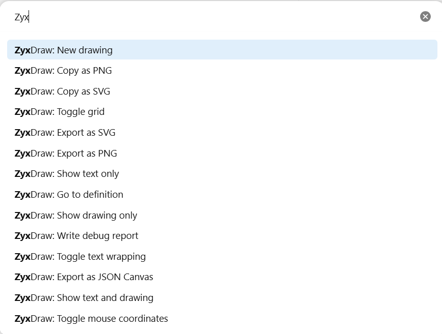

# Using ZyxDraw in Obsidian

## Getting started

- **New drawing:** right-click a folder in the file explorer and choose **New ZyxDraw drawing**, or use the ribbon icon or the command **ZyxDraw: New drawing**. It asks for the name, then creates and opens the `.zyxd` file.
- **New library:** right-click a folder and choose **New ZyxDraw library**, or use the command **ZyxDraw: New library** (it creates the file in the library folder from the settings). A dot in the name makes a folder: `cloud.aws` creates `cloud/aws.zyxdl`. The new library has one example shape and says how to import it.
- **Panels:** a drawing opens in panels. Drag the line between two panels to resize them; double-click it to reset.
  - **Left panel:** the text.
  - **Drawing area:** the drawing and its toolbar.
  - **Bottom panel**, under the drawing area: the **Attributes** of the selected shape. The **Attributes** button in the view header shows or hides it.
  - **Right panel**: the **Layers**. The **Layers** button in the view header shows or hides it.
- **Three views:** buttons in the view header, or the `ZyxDraw: Show ...` commands.
  - Text and drawing side by side (left panel and drawing area)
  - Text only (left panel)
  - Drawing only (drawing area)
- **Go to definition:** `Ctrl` + click (`Cmd` on Mac) on a name in the text: a custom shape (opens its library in a new tab), a library name in an import, an imported or exported name, a shape in `right-of=`, `from=`, ..., a style, a clip or a gradient. Hold `Ctrl` to see what is clickable. Also the command **ZyxDraw: Go to definition** (for the name at the cursor).
- **Hide shapes while you work:** click the eye next to a shape's line number in the text to hide it (it writes `display=none`); click again to show it. The lines of a hidden shape are faded. Hidden shapes keep their place, so shapes and lines attached to them do not move. See [Hiding shapes](language.md#hiding-shapes).
- **Comment lines:** `Ctrl+/` (`Cmd+/` on Mac) comments or uncomments the selected lines in the text.
- **In notes:** a fenced code block with the language `zyxd`, or an embed `![[diagram.zyxd]]`, shows the drawing.

## Editing in the drawing area

| Action | How |
| ------ | --- |
| Select | Click. The first click selects the outer group, clicking again goes one level deeper. Double-click selects the innermost shape |
| Select several | `Shift`+click adds or removes a shape; drag a box on empty space to select the shapes inside it; `Ctrl+A` selects all. Hidden shapes (`display=none`) are skipped. Move, nudge, delete, color, copy and group then work on all of them |
| Move | Drag, or arrow keys (Shift for 10 px) |
| Resize | Drag a handle (rectangles, circles, ellipses, groups with a size) |
| Edit points | Select a path, polygon, polyline or line: drag its points (squares) or curve control points (circles). A point takes its curve handles along, and a smooth point stays smooth when you drag one of its handles (hold `Alt` to make a corner). Only those numbers change in the text. With text and drawing side by side, clicking a point selects its numbers in the text |
| Delete | `Delete` or `Backspace` |
| Copy, cut, paste | `Ctrl+C`, `Ctrl+X`, `Ctrl+V` (`Cmd` on Mac), or right-click. Shapes are copied as Zyxd text, so they also paste into the text editor or another drawing. Names already used get a number (`box` → `box1`) |
| Duplicate | `Ctrl+D`, or right-click: a copy 10 px down and right, drawn on top |
| Group / ungroup | `Ctrl+G` / `Ctrl+Shift+G`, or right-click. Nothing moves on the canvas |
| Fill and stroke color | Toolbar color buttons: pick a color, none, or one of the file's gradients, for every selected shape |
| Layer order | Right-click: bring to front, forward, backward, send to back |
| Find in text | Right-click: Show in text |
| Add a shape | Toolbar: rectangle, circle, text |
| Draw a line | Toolbar line button (`L`): drag, or click both ends. Hold `Shift` for 45° steps |
| Draw a polygon | Toolbar polygon button (`P`): click to place points, click the first point or press `Enter` to finish |
| Draw a path (pen) | Toolbar pen button (`B`): click for a corner, press and drag for a smooth curve. Click the first point to close the shape, or press `Enter` (or double-click) to leave it open. `Backspace` removes the last point |
| Add / delete points | On a selected polygon, polyline or path, click or drag the dot in the middle of a side to add a point (on a curve, it splits the curve without changing its shape); click a point and press `Delete` to remove it |
| Attributes | Attributes button in the view header: a form under the drawing for the selected shape, or the canvas when nothing is selected. Press Enter or leave the field to apply; clear a field to remove the attribute |
| Zoom | Toolbar, or `Ctrl` + mouse wheel |
| Grid | Toolbar grid button: lines spaced to suit the zoom. While it is shown, moving, resizing and point dragging snap to it; hold `Alt` to drag freely |
| Mouse coordinates | Status bar shows the mouse position over the drawing, in pixels and percent. With a group, custom shape or path selected, also in that shape's own numbers (what you type in `d` or `points`). Toolbar crosshair button turns it off |
| Undo / redo | `Ctrl+Z` / `Ctrl+Shift+Z` (also in the drawing) |

Every drawing edit changes only the numbers it must in the text, keeps their unit (`10%` stays a percent), and is one undo step. Comments and formatting are kept. Dragging a shape that is anchored (`right-of=api 60`) along that axis replaces the anchor with a position, and a notice says so.

## Commands

The plugin, in its first version, comes with a lot of useful commands, and the list keeps growing.

## Export

Commands, or the file menu of a `.zyxd` file:

- **Export as SVG / PNG**: saved next to the drawing. PNG scale and background are in settings.
- **Export as JSON Canvas**: boxes, text, groups and connected lines become an Obsidian canvas. Other shapes are skipped with a notice.
- **Copy as SVG / PNG**: to the clipboard.

### Clipboard use

ZyxDraw uses the system clipboard only when you ask it to:

- It **writes** to the clipboard when you copy or cut shapes (`Ctrl+C`, `Ctrl+X`, or the right-click menu), or use **Copy as SVG / PNG**.
- It **reads** the clipboard only when you paste into the drawing (`Ctrl+V`, or **Paste** in the right-click menu).

Nothing is read in the background, and nothing leaves your device.

## Settings

- Default view (split, text, drawing).
- Wrap long lines in the text editor (also the command **ZyxDraw: Toggle text wrapping**).
- Show layer toggles in the text editor: the eye icons that hide and show shapes.
- Show grid, and show mouse coordinates (also toolbar buttons and the commands **Toggle grid** / **Toggle mouse coordinates**).
- Unit for new positions and sizes written by edits in the drawing area (percent or pixels).
- PNG scale and background.
- Library folder: where libraries shared by many drawings are kept (default `ZyxDrawLibrary`). An import looks next to the drawing first, then here.

In Obsidian 1.13 or later, these settings also show up in the settings search.
