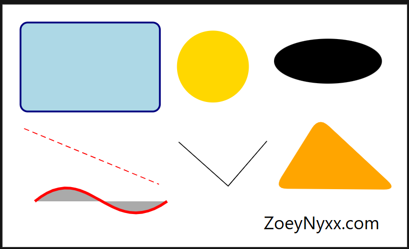

# Zyxd language reference

> Interim copy from the old README. The full reference is being written.

## Shapes

```text
canvas(width=450, height=270)

box is rect(x=20, y=20, width=155, height=99, radius=8, fill=lightblue, stroke=navy, stroke-width=2)
dot is circle(cx=234, cy=69, r=40, fill=gold)
oval is ellipse(x=302, y=38, rx=60, ry=25)
any_line is line(x1=24, y1=138, x2=174, y2=200, stroke=red, stroke-dasharray="6 4")
zig_zag is polyline(points="0,0 55,49 98,-1", fill=none, stroke=black, x=196, y=153)
tri is polygon(points="50,0 137,81 0,80", fill=orange, radius=15, x=302, y=125)
sine is path(d="M 0 0 C 60 -50 83 46 147 0", fill=#AAA, stroke=red, stroke-width=3, x=36, y=219)
footer is text("ZoeyNyxx.com", x=355, y=233, font-size=20, align=middle)
```

- `name is type(attributes)`. The name is optional; you only need it to refer to the shape.
- Attribute names and values follow SVG. Every attribute has a default.
- Long attribute lists may span several lines; commas are then optional.
- Comments start with `#`.
- `x` / `y` (or `left` / `top`) are the top-left of the shape's box. Circles and ellipses also take `cx` / `cy`.

It will produce the following drawing:



## Paths written as steps

A `path` draws with `d`, the same short text as in SVG: `d="M 20 20 L 180 20 L 100 160 Z"`. It can also be written as steps, one per line, in an indented block under `path(...):`. Each step says what it does:

```text
shield is path(fill=lightblue, stroke=navy, stroke-width=3):
  start(20, 20)
  line(180, 20)
  line(y=100)
  curve(100, 180, hx=180, hy=160)
  smooth(20, 100)
  close
```

This is the same path as `d="M 20 20 L 180 20 V 100 Q 180 160 100 180 T 20 100 Z"`, and the SVG gets exactly that `d`. A path has `d` or steps, never both.

| Step | What it draws | SVG |
| ---- | ------------- | --- |
| `start(x, y)` | The first point. Every path written as steps begins with it, and only the first step is `start`. | `M` |
| `jump-to(x, y)` | Begins a new part of the path at x, y, without drawing a line to it. | `M` |
| `line(x, y)` | A straight line to x, y. `line(x=...)` goes only across, `line(y=...)` only up or down. | `L`, `H`, `V` |
| `curve(x, y, x1, y1, x2, y2)` | A curve to x, y, pulled by two handles: x1, y1 near the start and x2, y2 near the end. | `C` |
| `curve(x, y, hx, hy)` | A curve to x, y, pulled by one handle, hx, hy. | `Q` |
| `smooth(x, y, x2=..., y2=...)` | A curve that goes on smoothly from the curve before: its first handle mirrors the last handle of that curve. | `S` |
| `smooth(x, y)` | The same after a one-handle curve: its handle mirrors the one before. | `T` |
| `arc(x, y, r=...)` | Part of a circle to x, y. `rx` and `ry` instead of `r` give part of an ellipse, and `turn` turns it (in degrees). `long=yes` takes the long way round, and `clockwise=no` goes the other way. | `A` |
| `close` | A straight line back to where this part began. | `Z` |

- **Values** are written in order, as in the table (`line(180, 20)`), or by name (`line(x=180, y=20)`), or both: `curve(100, 180, hx=180, hy=160)`. The values are plain numbers, as in `d`. Inside a custom shape they can be calculations with its parameters, like `line(size / 2, 0)`.
- **An arc** goes clockwise and the short way unless told otherwise: `long=no` and `clockwise=yes` are the defaults. `arc(180, 100, 80)` is the same as `arc(180, 100, r=80)`.
- **Relative steps:** add `-relative` to a step (`line-relative`, `curve-relative`, `smooth-relative`, `arc-relative`, `jump-to-relative`) and its numbers count from where the step starts instead of from the top-left: `line-relative(50, 0)` goes 50 to the right. Handles count from the start of the step too. These are SVG's lower-case commands (`l`, `c`, ...).

### `close` and open paths

`close` is written on its own, without `( )`, like `Z` in SVG. It draws a straight line back to the point where the part began (the `start`, or the last `jump-to`), and joins the two ends neatly.

The end of the indented block does **not** close the path. A path without `close` stays open: a wave, a curved arrow, or a line with several parts, like this one with two:

```text
streams is path(fill=none, stroke=steelblue, stroke-width=3):
  start(0, 20)
  curve(120, 20, hx=60, hy=0)
  jump-to(0, 60)
  curve(120, 60, hx=60, hy=40)
```

Each part can be closed on its own: a `close` before a `jump-to` closes the part before it. Two closed parts make a ring when the path has `fill-rule=evenodd`.

An open path is still filled (as in SVG): add `fill=none` to see only its line.

### Switching between `d` and steps

In the drawing area, right-click a path and choose **Write as steps** to turn its `d` into steps, or **Write as d** to turn its steps back into `d`. The drawing stays the same, and the numbers stay as they are written. Paths with calculations cannot be switched. Comments inside the block of steps are not kept when it becomes `d`.

The points of a path written as steps can be dragged in the drawing area: only the step's own numbers change. Adding and deleting points, bending a side, making a point smooth or a corner, and drawing on from an end work on paths written with `d` for now: use **Write as d** first.

## Position and size

Example code

```text
a is rect(x=10%, y=20, width=50%, height=40)     # percent of the parent (or canvas)
b is rect(right=20, bottom=20, width=100, height=50)  # from the right and bottom edges
c is rect(left=10%, right=10%, y=0, height=30)   # stretch: left + right set the width
d is rect(right-of=a 40, below=c 10)             # relative to other shapes, with a gap
```

- Relative: `right-of`, `left-of`, `above`, `below`. One per axis.
- There will be an error on any conflict. Example: two ways to place the same axis, opposite anchors, or a loop of anchors (`a` right of `b`, `b` right of `a`).
- `canvas(width=..., height=..., background=...)` sets the frame used for percent. Without it the frame is 1000 x 600.
- `canvas(infinite)` has no frame: the SVG is sized to what is drawn (plus 20 px), positions may be negative, and top-level shapes use pixels (`%` and `right` / `bottom` need a group with a size). The drawing area gives room to draw anywhere.

## Rotate and scale

```text
card is rect(x=150, y=50, width=100, height=50, rotate=30)        # degrees, clockwise
Nyxx is letter_z(color=gold, rotate=-57.5, scale=1.1)                  # custom shapes too
back is polygon(points="0,20 60,20 60,0 100,40 60,80 60,60 0,60", scale=-1 1)   # mirror
```

Around the center of the shape's box. They change only the drawing: positions, anchors and `%` use the unturned box. `scale` takes one number, or two (horizontal, vertical).

## Groups

```text
server is group(x=100, y=50):
  box is rect(width=200, height=100, fill=lightgray)
  title is text("API Server", x=10, y=10)

line(from=server.box, to=db)
```

Attributes go in `( )`, children are indented below `:`. Names only need to be unique among siblings; refer to a child as `server.box`. Children are placed from the group's top-left. A group whose children use `%` needs a `width` and `height`.

## Layers

```text
background is layer():
  sky is rect(width=100%, height=100%, fill=lightblue)
shapes is layer():
  sun is circle(x=80%, y=10%, r=20, fill=gold)
```

A layer is a group for one part of the drawing. It is written at the top level only (not inside a group, a custom shape or another layer), and without a `width` / `height` it covers the canvas, so `%` works inside it. Later layers are drawn in front. In SVG it is a plain `<g>`.

The **Layers** view in the right panel lists every top-level shape, group and layer, front-most first; layers and groups open to show their shapes. Click a row to select the shape; its layer becomes the **active layer**, and new shapes you draw or paste go into it. The eye on a row hides or shows it (`display=none`), **+** adds a new layer. Drag a row to put it in front of or behind another row, or into a layer or group; the shape stays in place on the canvas. Right-click a row to delete it. A click in the drawing selects what is in a layer, never the whole layer.

Shapes can refer to shapes in any layer, in front or behind (`right-of=back.sky`): the whole drawing is read before anything is placed. Moving a shape to another layer changes its path (`back.sky` becomes `front.sky`), so before such a move or a delete breaks a reference, ZyxDraw lists what would break and lets you go ahead or cancel.

## Styles

```text
card is style(fill=white, stroke=gray, stroke-width=2, radius=8)
a is rect(width=100, height=60, style=card)
b is rect(width=100, height=60, style=card bold, fill=yellow)   # own attributes win
```

Several styles apply left to right. Styles cannot set positions.

## Hiding shapes

```text
back is rect(width=300, height=200, fill=lightgray, display=none)
front is rect(x=20, y=20, width=100, height=60, fill=orange)
```

`display=none` hides a shape, a group or a custom shape, as in SVG. It still has its place, so anchors (`right-of=back`) and lines to it keep working. It is saved in the file and exported as `display="none"`. The eye next to each shape in the text editor adds or removes it. Hidden shapes cannot be selected in the drawing.

## Clipping

```text
top-half is clip():
  rect(width=100%, height=50%)

c is circle(cx=50, cy=50, r=50, fill=red, clip-path=top-half)
```

Only the parts inside the clip's shapes stay visible. Shapes in a clip are placed in the clipped shape's box (`%` of that shape), so one clip fits any size. Works on groups too.

## Gradients

```text
canvas(width=400, height=240, background=sky)
sky is gradient(from=#7a2a5a, to=#f6c3a8, angle=90)
sun is gradient(type=radial, from=#fff6c8, to=#ff9a5a)
glow is gradient(type=radial):
  stop(offset=0%, color=#ffd36e, opacity=0.9)
  stop(offset=100%, color=#ffd36e, opacity=0)

halo is circle(cx=300, cy=80, r=70, fill=glow)
ball is circle(cx=300, cy=80, r=35, fill=sun)
```

A gradient is used by name wherever a color goes: `fill`, `stroke`, `background`, styles and custom shape parameters. `angle` turns a linear gradient (0 = left to right, 90 = top to bottom); `type=radial` blends from the center outwards. More colors go in indented `stop(...)` lines, and a color fading to `opacity=0` gives a soft glow. It stretches over each shape's box, and is written as a plain SVG `linearGradient` / `radialGradient`.

## Custom shapes and libraries

```text
database is shape(label, width=120, height=80, color=steelblue):
  body is rect(width=100%, height=100%, fill=color, radius=10)
  name is text(label, x=10, y=30)

users is database(label="Users", x=20, y=20)
orders is database(label="Orders", right-of=users 40, y=20, color=orange)
```

- A parameter without a default is required.
- Numbers can be calculations using the parameters: `rx=width / 2`, `y=(height - 20) / 2`. Put spaces around `-` (names may contain `-`).
- In `points` and `d`, put a calculation in `( )`: `points="0,(height) (aim),(height + length) 20,(height)"`. The exported SVG gets plain numbers.
- Instances take their parameters plus position and style attributes.
- Inner parts of a shape from the same file can be referenced (`users.body`). Imported shapes are sealed.

To use shapes in many drawings, put them in a **library**: a `.zyxdl` file. A library holds custom shapes, styles, gradients and clips, and draws nothing. A drawing (`.zyxd`) cannot be imported.

```text
# shapes/system.zyxdl
label is style(font-size=14)

service is shape(label, width=140, height=60):
  body is rect(width=100%, height=100%, radius=8)
  name is text(label, x=50%, y=20, align=middle, style=label)

export service

# Shown only when this library is open in ZyxDraw
preview():
  service(label="Checkout")
```

```text
# A drawing
import service from shapes.system
import * from shapes.system
import service as box from shapes.system
```

- The **library name** is the file's path with dots between folders: `shapes.system` is `shapes/system.zyxdl`. No `/`, no extension. Folder and file names of libraries use letters, digits, `-` and `_` (no dots), and upper and lower case count.
- An import looks next to the drawing first, then in the **library folder** from the settings (`ZyxDrawLibrary` by default).
- `export a, b` lists what other files can import. Without it, everything is exported. A library can export what it imported.
- `import *` brings in everything exported. `as` gives an imported name another name in this file.
- Later imports override earlier ones, and a local definition always wins. Circular imports and definitions are reported.
- Create a library with **New ZyxDraw library** in a folder's right-click menu, or the command **ZyxDraw: New library**.
- `preview():` lists example uses of the library's shapes, written as in a drawing but without `x` and `y`. It is only shown when the library is open: drawings that import the library never draw it.
- **Open a library** to see all its custom shapes in a grid, each with its name ("not exported" for shapes left out of `export`). A shape without a line in `preview()` uses its defaults, and a parameter without a default shows its own name.
  - Click a shape, or put the text cursor on its line, to try other values in the **Attributes**: they are written to `preview()`, never to the shape itself. The first value for a shape adds its line (and the `preview():` block when there is none).
  - The eye next to a `name is shape(...):` line hides that shape in the drawing area only. The eye next to a line in `preview()` writes `display=none` there.
  - Shapes cannot be moved or added in a library's drawing area, and there are no Layers.

### Ready-made libraries

The [library](../library/) folder of this repository has libraries you can use, such as `shapes.speech`: speech bubbles `say`, `think` and `whisper`, whose tail points at any spot (`tip-x` and `tip-y`, measured from the middle of the bubble), plus `shout` and `caption`; `text-size` sets the size of the words. [examples/17_speech_bubbles.zyxd](../examples/17_speech_bubbles.zyxd) is a short comic made with them. For now, copy a `.zyxdl` file into your library folder, keeping its folders (`shapes/speech.zyxdl`), then import its shapes:

```text
import say, think from shapes.speech

hello is say(label="Hello!", x=20, y=20, tip-x=-60, tip-y=70)
idea is think(label="What if...", x=220, y=20)
```

[library/README.md](../library/README.md) lists every library and explains how to contribute one. Installing libraries from inside ZyxDraw is planned.
