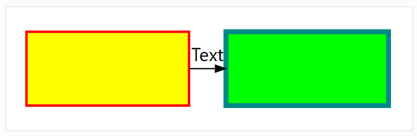
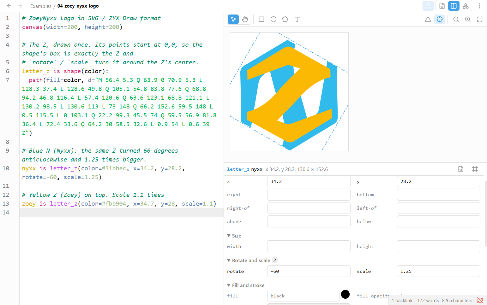

# Tutorial: your first drawings

> Interim copy of the tutorial from the old README. A proper step-by-step tutorial will replace it.

## First example

Consider the following text

```
canvas(width=330, height=100)

primary is style(fill=yellow, stroke=red, stroke-width=2)
secondary is style(fill=rgb(0, 255, 0), stroke=#088, stroke-width=4)

block_a is rect(top=20%, left=5%, width=40%, height=60%, style=primary)
block_b is rect(
  right-of=block_a 30,
  top=20,
  width=40%
  height=60
  style=secondary
)

line(from=block_a, to=block_b, arrow=end, label="Text")
```

It will generate the following drawing



Not a fan of text? The drawing area is also a proper drawing editor. Writing a drawing as text is completely optional and just gives us some extra powers to make drawings much easier and quicker. Let's quickly check what is written in the text of the above example.

### Canvas

Zyxd text usually starts with the canvas size, like

```
canvas(width=330, height=100)
```

Without it, the canvas is 1000 x 600. If you need an infinite canvas, you can have it too

```
canvas(infinite)
```

> An image can't be infinite. When exporting an infinite canvas, the generated SVG or image has a height and width that cover all drawing elements (plus 20 px).

### Styles

#### Primary

We can define some of the styles that we may reuse later. The following line does just that

```
primary is style(fill=yellow, stroke=red, stroke-width=2)
```

The syntax is `name is type`. Here, `primary` is just a name that we want to refer to later, while applying the style.

`style` is a reserved keyword to represent styles. This means you cannot use `style` as a name. The other reserved keywords are `is`, `shape`, `clip`, `gradient`, `canvas`, `import`, `export` and `layer`, and the built-in shape types (`rect`, `circle`, `polygon`, ...) cannot be names either. In a library, `preview` is reserved too.

After style, we have `()`. Within it, we have attributes, which are in the format `attribute=value`. There is a huge list of attributes, which we will see later in detail. They are also listed in the **Attributes**, in the bottom panel under the drawing area.

#### Secondary

Similarly, we defined `secondary` style too as

```
secondary is style(fill=rgb(0, 255, 0), stroke=#088, stroke-width=4)
```

It is the same as the primary style, but it shows examples of writing colors. We can write colors as:

- `Name` like `red` and `yellow`
- `RGB code` like `rgb(0, 255, 0)` (Green color)
- `Color hex` like `#088` (which is the same as `#008888`) (Teal, a darker shade of cyan - by mixing green and blue)

### Shapes

#### block_a

Like styles, the second important part of ZyxDraw is shapes. A shape defines the boundaries of a drawing object. There are some basic shapes built in, like rectangle (`rect`). The next line draws a rectangle with a predefined style

```
block_a is rect(top=20%, left=5%, width=40%, height=60%, style=primary)
```

You can probably read the syntax now. `block_a` is the name to refer to later in the drawing. `rect` is a built-in shape. Its attributes define how to draw the rectangle.

- `top=20%`: Since the height is 100 (pixels), 20% will start at 20 pixels.
- `left=5%`: We have a width of 330 pixels. So 5% will be 16.5 pixels.
- `width=40%`: 132 pixels (40% of the width, 330 pixels)
- `height=60%`: 60 pixels (60% of the height, 100 pixels)
- `style=primary`: Here we reuse the style we defined earlier. This reuse is the power of ZyxDraw. It will apply all the attributes we defined in style `primary`.

> We can also define things in exact coordinates and pixels.

#### block_b

We defined `block_b` as:

```
block_b is rect(
  right-of=block_a 30,
  top=20,
  width=40%
  height=60
  style=secondary
)
```

There is nothing special. It is defined just like block_a, with different attribute values and a different style. One new thing is `right-of=block_a 30`: instead of an `x` position, `block_b` is placed 30 pixels to the right of `block_a`, so it follows when `block_a` moves. If there are too many attributes, we can define them on multiple lines for easier reading.

When we define attributes on multiple lines, the comma is optional (we have a comma after the first two values but not after the last three). However, it is recommended to stick to a single style.

#### Line

At the end, we have a line

```
line(from=block_a, to=block_b, arrow=end, label="Text")
```

We can obviously define exact coordinates of start and end of line. However, in this example, we defined it in reference to existing shapes (`from=block_a, to=block_b`). This is another super-power of ZyxDraw: making relationships between shapes.

We also have the attribute `arrow=end`. So a line in ZyxDraw can act as an arrow, depending on the `arrow` attribute. Possible values are: `none`, `start`, `end`, `both`. If we do not define the arrow attribute, default is `none`, which is just a line.

## Second example: a logo

Before diving deep, let's take one more example, a bit more complex (curved lines), but it is also simple.



This example shows how I made the Zoey Nyxx logo in ZyxDraw, with the following Zyxd text

```
canvas(width=200, height=200)

# The Z, drawn once. Its points start at 0,0, so the shape's box is exactly the Z.
letter_z is shape(color):
  path(fill=color, d="M 56.4 5.3 Q 63.9 0 70.9 5.3 L 128.3 37.4 L 128.6 49.8 Q 105.1 54.8 83.8 77.6 Q 68.8 94.2 46.8 116.4 L 57.4 120.6 Q 63.6 123.1 68.8 121.1 L 130.2 98.5 L 130.6 113 L 73 148 Q 66.2 152.6 59.5 148 L 0.5 115.5 L 0 103.1 Q 22.2 99.3 45.5 74 Q 59.5 56.9 81.8 36.4 L 72.4 33.6 Q 64.2 30 58.5 32.6 L 0.9 54 L 0.6 39 Z")

# Blue N (Nyxx): the same Z turned 60 degrees anticlockwise and 1.25 times bigger.
nyxx is letter_z(color=#31bbec, x=34.2, y=28.2, rotate=-60, scale=1.25)

# Yellow Z (Zoey) on top, 1.1 times bigger.
zoey is letter_z(color=#fbb904, x=34.7, y=28, scale=1.1)
```

I'll leave you to read the text above. Some of the features it uses:

- Comments start with `#`. They do not take part in the drawing; they are for us, to later recall why we wrote a line.
- Custom shape (`letter_z`): If you know some programming, consider it a function. A custom shape groups together multiple shapes that we may reuse later.
  - There is some syntax though, which is inspired by the Python programming language.
    - A custom shape block starts after `:`
    - A custom shape block has indentation. You can see two spaces before `path`; that space makes `path` part of `letter_z` (not an individual shape)
  - ZyxDraw also supports libraries: a group of common shapes that we may reuse in multiple drawings.
- `path` may look strange, but it is a simple SVG path. You can read about it online, or we will see more examples/tutorials to define paths.
  - An easier option in ZyxDraw and SVG is the polygon (when you do not need curves). I used a path as there are some curves in our shape.
- Once we defined the shape `letter_z`, we can reuse it in the next two lines:
  - `nyxx` is the same letter in blue, rotated 60 degrees counter-clockwise. It is also scaled (enlarged) by 1.25 (125%).
  - Then, `zoey` is the same shape in yellow, scaled only 1.1 (110%) this time.
  - You may also notice layering. Any shape drawn later is drawn above the previously drawn shapes.


Next: the [language reference](language.md) and [editing in the drawing area](editing.md).
